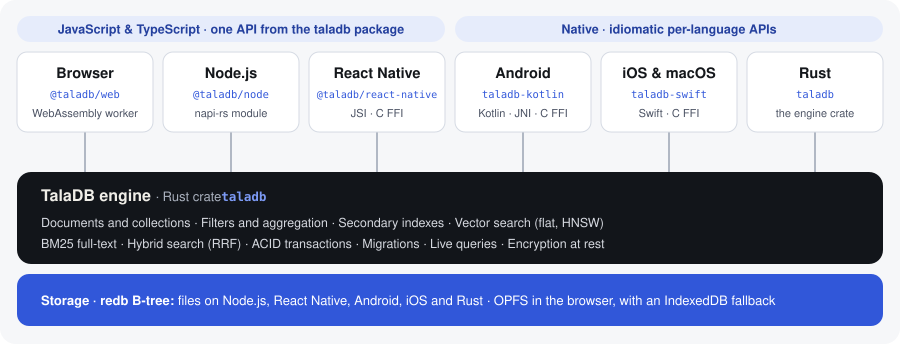

<p align="center">
  <a href="https://taladb.dev">
    <picture>
      <source media="(prefers-color-scheme: dark)" srcset="docs/public/logo-dark.svg">
      
    </picture>
  </a>
</p>

<p align="center">
  <strong>One database. Everywhere your app runs.</strong><br>
  An embedded document and vector database with a Rust core,<br>
  for browser, server and mobile apps.
</p>

<p align="center">
  <a href="https://www.npmjs.com/package/taladb"></a>
  <a href="https://crates.io/crates/taladb"></a>
  <a href="https://github.com/taladb/taladb/actions/workflows/ci.yml"></a>
  <a href="#license"></a>
</p>

<p align="center">
  <a href="https://taladb.dev"><strong>Documentation</strong></a> ·
  <a href="https://taladb.dev/introduction">Get started</a> ·
  <a href="https://demo-web.taladb.dev/">Web demo</a> ·
  <a href="https://github.com/taladb/taladb/releases">Changelog</a>
</p>

---

TalaDB stores JSON documents and their vector embeddings in one embedded engine. You
query them with MongoDB-style filters, secondary indexes, and vector, full-text and
hybrid search, all inside your app process. There is no server to run and no cloud
round-trip. The same Rust core runs in the browser, on Node.js, and in React Native,
Android, iOS and macOS apps.

## Quickstart

Browser example. Node.js uses `@taladb/node` and React Native uses
`@taladb/react-native` with the same code. Kotlin, Swift and Rust are covered under
[Platforms](#platforms).

```bash
pnpm add taladb @taladb/web
```

```ts
import { openDB } from 'taladb'

const db = await openDB('app.db') // OPFS in the browser, a file elsewhere
const articles = db.collection('articles')

await articles.createVectorIndex('embedding', { dimensions: 384 })
await articles.insert({
  title: 'How to reset your password',
  locale: 'en',
  embedding: await embed('How to reset your password'), // any embedding model
})

// Structured query
const english = await articles.find({ locale: 'en' })

// Filter on metadata first, then rank the matches by similarity
const similar = await articles.findNearest('embedding', await embed('forgot my login'), 5, {
  locale: 'en',
})
```

Browser apps also need a small bundler setup (cross-origin isolation headers for the
OPFS worker). See the [browser guide](https://taladb.dev/guide/web#vite-setup).

## Architecture

<p align="center">
  
</p>

Each platform has a thin binding over the `taladb` crate: WebAssembly in the browser,
napi-rs on Node.js, and the C FFI behind React Native (JSI), Kotlin (JNI) and Swift.
Filters, indexes and search behave the same everywhere. Storage and API style follow
each platform's conventions. More in [Introduction](https://taladb.dev/introduction#architecture-overview).

## Capabilities

- **Documents and queries.** Collections of JSON documents with MongoDB-style
  [filters](https://taladb.dev/api/filters), [updates](https://taladb.dev/api/updates),
  [aggregation](https://taladb.dev/api/aggregation) and secondary indexes picked by the
  query planner.
- **Vector search.** Exact k-NN (cosine, dot, euclidean) by default, optional HNSW, and
  metadata filters applied before ranking. See [vector search](https://taladb.dev/api/vector-search).
- **Full-text and hybrid search.** BM25 ranking with `searchText`, and `hybridSearch`
  that fuses keyword and vector rankings with reciprocal rank fusion. See
  [search](https://taladb.dev/api/search).
- **Transactions and persistence.** ACID writes on [redb](https://github.com/cberner/redb).
  Optional AES-GCM-256 [encryption at rest](https://taladb.dev/api/encryption).
- **Live queries and migrations.** [Subscribe](https://taladb.dev/api/live-queries) to a
  filter, and version your data with [migrations](https://taladb.dev/api/migrations)
  that run on open.
- **Change webhook.** TalaDB does not replicate. If your backend needs to hear about
  local writes, a [webhook](https://taladb.dev/api/webhook) can send each committed
  change (JavaScript runtimes).

## Platforms

| Platform | Package | Binding | Guide |
|---|---|---|---|
| Browser | `taladb` + `@taladb/web` | WebAssembly in a worker; OPFS, IndexedDB fallback | [Browser](https://taladb.dev/guide/web) |
| Node.js | `taladb` + `@taladb/node` | napi-rs native module | [Node.js](https://taladb.dev/guide/node) |
| React Native | `taladb` + `@taladb/react-native` | JSI over the C FFI | [React Native](https://taladb.dev/guide/react-native) |
| Android (Kotlin) | `dev.taladb:taladb-android` ([taladb-kotlin](https://github.com/taladb/taladb-kotlin)) | JNI over the C FFI | [Android](https://taladb.dev/guide/android) |
| iOS & macOS (Swift) | [taladb-swift](https://github.com/taladb/taladb-swift) via SwiftPM | C FFI | [Swift](https://taladb.dev/guide/swift) |
| Rust | [`taladb`](https://crates.io/crates/taladb) | The engine crate | [Rust](https://taladb.dev/guide/rust) |

React apps can add `@taladb/react` for hooks ([guide](https://taladb.dev/guide/react)).
`@taladb/node` ships prebuilt binaries for `linux-x64`, `darwin-arm64` and `win32-x64`.

<details>
<summary>Install commands for native apps</summary>

**Android (Kotlin)**, minSdk 24, Kotlin 2.2+:

```kotlin
dependencies {
    implementation("dev.taladb:taladb-android:0.2.3")
}
```

**iOS & macOS (Swift)**, iOS 13+ / macOS 10.15+, Swift 5.9+:

```swift
.package(url: "https://github.com/taladb/taladb-swift", from: "0.2.3")
// target dependency: .product(name: "TalaDB", package: "taladb-swift")
```

**Rust**, 1.90+:

```bash
cargo add taladb
```

</details>

## Project links

- [Documentation](https://taladb.dev) and [API reference](https://taladb.dev/api/collection)
- Live demos: [web](https://demo-web.taladb.dev/), [React Native](https://play.google.com/store/apps/details?id=dev.thinkgrid.kepta) and [Android (Kotlin)](https://play.google.com/store/apps/details?id=dev.thinkgrid.notewell) on Google Play
- [Example: local-first storefront](examples/vite-spa-storefront) (Vite + `@taladb/react/query`)
- [Changelog](CHANGELOG.md) · [Releases](https://github.com/taladb/taladb/releases) · [Roadmap](https://taladb.dev/roadmap)
- [Discussions](https://github.com/taladb/taladb/discussions) · [Sponsor](https://github.com/sponsors/tala-sh)

## Development

You need Rust 1.90+ (the repo pins its toolchain in `rust-toolchain.toml`), Node.js 18+,
pnpm 9+ and wasm-pack.

```bash
pnpm install
pnpm build              # every package
cargo test --workspace  # Rust tests
pnpm docs:dev           # docs site at http://localhost:5173
```

[CONTRIBUTING.md](CONTRIBUTING.md) has the full workflow, including the browser
(WASM) tests and the Node.js native build.

## Contributing

Bug reports, pull requests and feedback are welcome. Please open an issue before
starting a large feature or an architectural change.

## License

Dual-licensed under either of

- Apache License, Version 2.0 ([LICENSE-APACHE](LICENSE-APACHE))
- MIT license ([LICENSE-MIT](LICENSE-MIT))

at your option.

Unless you explicitly state otherwise, any contribution intentionally submitted
for inclusion in this project shall be dual-licensed as above, without any
additional terms or conditions.
